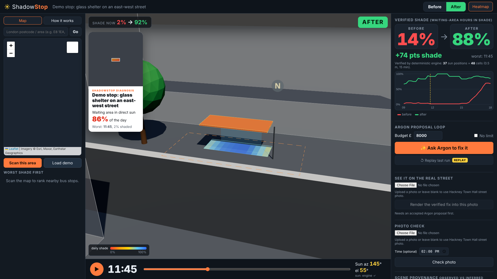

# ShadowStop

**Find the bus stops that leave people standing in the sun, and design shade that's proven to work.**

On a heatwave day, people waiting for a bus stand in full sun, often under a "shelter" with a clear roof. ShadowStop scans every stop in an area, rebuilds each stop in 3D from OpenStreetMap plus Gemini 4 Argon's reading of street photos, and computes how much of the waiting area is actually shaded through the day. Argon then designs a canopy or tree, and **a deterministic geometry engine accepts or rejects every design**. Nothing on screen is a generated picture of success: every number is ray-cast from the real sun position.

[](https://github.com/resenorlando/shadowstop/actions/workflows/tests.yml)

> **Hackney Town Hall** (a real stop, built from OpenStreetMap), July day: **14%** of the waiting area is shaded. The "obvious fix" (a solid roof) is **rejected** by the verifier: +14 pts only, and at 09:00 (sun az 99°, el 34°) **0%** of the waiting area is shaded. Argon's first shade sail is rejected at 18:00 (13% shaded); its redesign, made from that counterexample, is **accepted: 14% → 77%** for £3,350 (indicative) under an £8,000 budget.
>
> The before score and the rejection (same reason string, same 37 quarter-hour values) are re-computed from `scenes/hackney_town_hall.json` by `tests/test_api.py`, and the accepted 77% (all 37 quarter-hour values) from `scenes/hackney_accepted.json` by `tests/test_hackney_accepted.py`; the Argon attempts are the recorded run in `web/assets/hero.json`. Synthetic demo scene: 14% before, obvious fix rejected at 11:45 (17% shaded), stored canopy accepted at 88%.



## How the verifier works
- **Grid and time:** the waiting area is sampled on a 0.5 m grid at 1.2 m (torso height), every 15 minutes across the stop's hours (default 09:00–18:00 local).
- **Sun:** NOAA solar equations (with atmospheric refraction) give the sun's azimuth and elevation for the stop's latitude, longitude, date and UTC offset.
- **Ray casting:** from each grid point a ray goes toward the sun and is tested against buildings, shelters and canopies (prisms) and tree crowns (ellipsoids); partial opacity lets some light through (e.g. glass roofs).
- **Accept rules:** at least +25 points of daily shade, at least 40% of the waiting area shaded at the worst sun-up moment, buildable (underside 2.3–4.5 m, ≤ 24 m², inside the buildable zone, not in a building) and within budget.
- **Counterexample:** a rejection names the worst time with the sun's azimuth, elevation and shade %, and that goes back to Argon to redesign; no model output ever sets a score, cost or opacity.

## How it works
```
OpenStreetMap ─┐                     ┌─> Argon proposes a canopy/tree ─┐
(stops, buildings, trees, roads)     │                                 │
               ├─> 3D scene ─> VERIFIER (sun position + ray casting) <─┘  accept / reject + counterexample
Street photos ─┘   ▲                     │
 (Argon reads what │                     └─> shade score, heat map, worst time of day
  the map gets     │
  wrong)           └── Photo check: a real timestamped photo must show sun/shade where the model predicts it
```

| Part | Who does it | File |
|---|---|---|
| Find stops, buildings (with heights), trees, kerb direction | OpenStreetMap (Overpass, falls back to the OSM API) | `shadowstop/osm.py` |
| Correct the map from photos (e.g. *"OSM says shelter=yes but the roof is clear polycarbonate"*), find where people really wait | **Gemini 4 Argon** | `shadowstop/argon.py` |
| Sun position (NOAA equations), ray casting, shade score, buildability rules | **Deterministic verifier** (no model calls) | `shadowstop/sun.py`, `geometry.py`, `engine.py` |
| Design a fix; read the verifier's rejection and try again | **Gemini 4 Argon** | `argon.propose_fix` |
| Reality check against a timestamped photo | Argon reads the photo; the verifier predicts it | `/api/photo-check` |
| Draw the **verified** design into the user's own street photo | **Nano Banana 2.1** (only after the design passes; re-verified server-side) | `argon.render_fix`, `/api/render-fix` |
| Approve the design before exporting a council brief | **A human** (export is locked until "Approve") | `web/app.js` |

**The rule: Argon reads and proposes; the verifier decides.** A proposal is accepted only if it:
- adds at least **+25 points** of shade over the day;
- keeps at least **40%** of the waiting area shaded at the worst moment;
- fits buildability limits: underside 2.3–4.5 m, area ≤ 24 m², inside the pavement zone, not inside a building.

A rejected proposal goes back to Argon with the counterexample (time, sun azimuth and elevation, shade %).

Argon is called through the **Interactions API** (`thinking_level` from env `SHADOWSTOP_THINKING`, default `low` for demo speed). Each retry is chained with `previous_interaction_id`, so Argon keeps its own earlier reasoning server-side while it reads the verifier's objections. If the Interactions call fails, it falls back to `generate_content` so a live demo never stalls. The photo images Nano Banana returns are illustrations; **every shade number comes from the verifier, not from a picture.**

## Run it
```bash
pip install -r requirements.txt
```
```bash
setx GEMINI_API_KEY "<your key>"
```
```bash
python -m uvicorn shadowstop.server:app --port 8000
```
Open http://localhost:8000. On Windows, `./run.ps1` picks the key up from your user environment.

Tests (known-answer checks of the sun and the geometry):
```bash
python -m pytest -q
```

**Demo film:** open http://localhost:8000/story_v1.html and press Play (space pauses). It runs 55 s at 1920×1080 on the real Hackney Town Hall data in `web/assets/hero.json`. The interactive version is at http://localhost:8000/story.html. To record the film to MP4 (needs internet for the map tiles and the server running):
```bash
cd showcase-tools && npm install && npx playwright install chromium && node record.js
```
Output: `showcase-tools/out/shadowstop_demo.mp4`.

## Deploy
```bash
docker build -t shadowstop .
```
```bash
docker run -p 8000:8000 -e GEMINI_API_KEY=... shadowstop
```
Cloud Run (the container honours `$PORT`): `gcloud run deploy shadowstop --source . --set-env-vars GEMINI_API_KEY=...`. Without a key, the 3D scene, scoring and verifier still work; only Argon and Nano Banana need it. CI runs the test suite (no network, no key) on every push.

## API
| Endpoint | What it does |
|---|---|
| `GET /api/scan?south&west&north&east` | Every bus stop in the box with a baseline shade score, worst first |
| `GET /api/scene/from_osm?lat&lon` | Builds the 3D scene for one stop |
| `GET /api/scene/demo` | The rehearsed demo scene |
| `POST /api/score {scene, include_proposals}` | Shade score, by time of day, heat-map cells, worst time |
| `POST /api/propose {scene, budget_gbp}` | Obvious fix → Argon attempts → verdicts → final scene, plus a brute-force reference search |
| `POST /api/read-scene` (photos + scene) | Argon corrects the scene from photos |
| `POST /api/photo-check` (photo + scene) | Predicted vs observed sun/shade at named points of a real photo |
| `POST /api/render-fix` (photo + scene) | Re-verifies the design, then Nano Banana 2.1 draws it into the photo |
| `GET /api/sun?lat&lon&date&time&utc_offset` | Sun azimuth and elevation |
| `POST /api/heatgrid` | Shade heat grid around the stop for the map overlay |
| `GET /api/satellite-eye?lat&lon` | Argon reads the aerial image around a stop and returns labelled detections |
| `GET /api/geocode?q` | London postcode / area → coordinates |

Scene format: [SCENE_SCHEMA.md](SCENE_SCHEMA.md).

## Limits (read before trusting a number)
- **Shade is direct sunlight blocked at torso height (1.2 m)** over the waiting area, 15-minute steps. It isn't air temperature, radiant heat or UV index.
- **Heights come from OSM tags.** Where they're missing, the default is 9 m (shown as low confidence). Tree crowns are estimated from height.
- **Glass and foliage are modelled as partial opacity** (glass 0.1, foliage 0.7), not optics.
- **Argon's scene corrections are only as good as the photos**, and every Argon-sourced object is labelled with its evidence and confidence in the UI.
- **The brute-force reference search is coarse** (1 m grid, hourly steps, 4 canopy sizes), so a good Argon design can beat it.
- This is a **geometry-backed estimate for prioritising stops**, not a certified structural or planning design.

## Credits
Map data © [OpenStreetMap](https://www.openstreetmap.org/copyright) contributors (ODbL). Cached responses for the demo area are in `scenes/cache/`.
